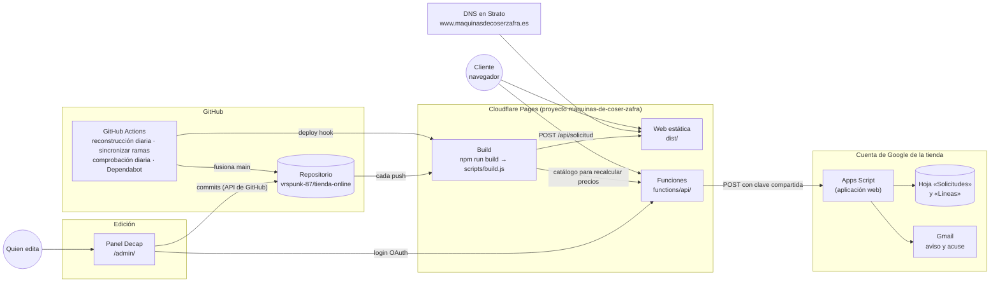
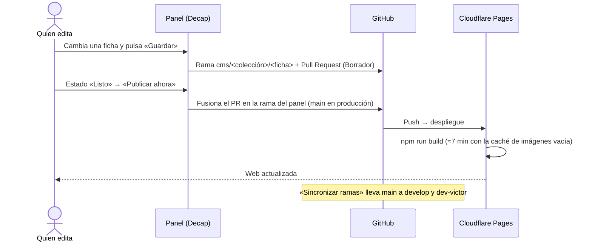
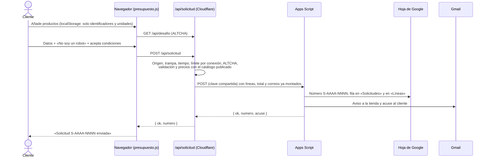

# Arquitectura de la web — Máquinas de Coser Zafra

Documento de arquitectura: qué piezas forman la web, cómo se comunican, dónde vive cada dato y por qué
se eligió así. El detalle de cada pieza está en los **diseños técnicos** de [`docs/diseno/`](diseno/)
(índice al final). Estado a 22-11-2026.

> Para usar la web y el panel (sin entrar en el código), ver los manuales en PDF de
> [`docs/manuales/`](manuales/). Para el plan de trabajo y las decisiones con fecha, [`PLAN.md`](PLAN.md).

## 1. Qué es

Una **tienda sin venta en la web**: un catálogo de máquinas de coser, accesorios y planchado con **precios
orientativos (IVA incluido)**, donde el cliente prepara una **solicitud de presupuesto** y la envía. La
solicitud llega a una hoja de Google con un aviso por correo a la tienda y un acuse al cliente; la venta se
acuerda después, fuera de la web. No hay usuarios, ni cuentas de cliente, ni pagos, ni stock.

Requisitos que han guiado la arquitectura:

| Requisito | Consecuencia |
|---|---|
| Coste casi nulo, sin servidores que mantener | Web **estática** generada en cada despliegue + funciones mínimas en Cloudflare |
| La tienda edita sin saber informática | Panel **Decap CMS** sobre el repositorio, con campos y tablas propios |
| Unos 500 productos con hasta 5 fotos, cargas en bloque | Contenido en ficheros (Markdown/YAML) en Git; Excel ↔ panel |
| Solicitudes con datos personales | Sin base de datos propia: hoja de Google de la tienda; validación y precios en el servidor |
| Cloudflare gratuito prohíbe cobrar con tarjeta | Nunca un formulario de pago |
| Seguridad sin mantenimiento | Sin scripts en línea (CSP), nada de CDN externos, HTML saneado, claves fuera del código |

## 2. Vista general

## 3. Componentes

| Componente | Tecnología | Qué hace | Diseño técnico |
|---|---|---|---|
| **Contenido** | Markdown y YAML en `public/_*` | Productos, fabricantes, catálogo (3 niveles), blog, páginas, datos de la tienda y ajustes | [Modelo de datos](diseno/MODELO-DE-DATOS.md) |
| **Generador** | Node 22, `scripts/build.js` (+ `layout.js`) | Convierte `public/` en `dist/`: páginas, imágenes WebP, SEO, buscador, sitemap, RSS, datos del panel y de las funciones | [Generador](diseno/GENERADOR.md) |
| **Web pública** | HTML estático, Bootstrap 5, JS propio sin dependencias | Catálogo, fichas, filtros, buscador (Pagefind), solicitud en el navegador | [Web en el navegador](diseno/FRONTEND.md) |
| **Panel** | Decap CMS 3.3.3 + módulos propios en `public/admin/` | Edición con flujo editorial, tablas, Excel, Medios, vistas previas | [Panel](diseno/PANEL.md) |
| **Funciones** | Cloudflare Pages Functions (`functions/api/`), lógica en `lib/` | Login del panel con GitHub; recepción de solicitudes con ALTCHA; diagnóstico | [Solicitudes](diseno/SOLICITUDES.md), [Seguridad](diseno/SEGURIDAD.md) |
| **Hoja de solicitudes** | Google Apps Script (`docs/solicitudes/apps-script.gs`) + Sheets + Gmail | Numera, guarda y manda los dos correos | [Solicitudes](diseno/SOLICITUDES.md) |
| **Despliegue y tareas** | Cloudflare Pages + GitHub Actions + Dependabot | Entornos por rama, reconstrucción diaria (ofertas), sincronización de ramas, comprobación diaria | [Despliegue](diseno/DESPLIEGUE.md) |

## 4. Flujos principales

### 4.1 Publicar un cambio desde el panel (flujo editorial)

El engranaje del panel (Excel, cambios en bloque, eliminar con dependencias, Medios) **no** usa el flujo
editorial: escribe todo en **un único commit** directo en la rama del panel ([Panel](diseno/PANEL.md)).

### 4.2 Solicitud de presupuesto

### 4.3 Otros flujos

| Flujo | Disparador | Qué pasa |
|---|---|---|
| Login del panel | «Iniciar sesión con GitHub» | `/api/auth` → GitHub → `/api/callback`; el token solo se entrega a webs de la lista exacta (`lib/origenes.js`) |
| Ofertas que empiezan o acaban | 00:07 hora de Madrid | `reconstruccion-diaria.yml` llama al *deploy hook* de producción |
| Ramas de pruebas al día | Cada push a `main` | `sincronizar-ramas.yml` fusiona `main` en `develop` y `dev-victor` (PR si hay conflictos) |
| Vigilancia | 06:41 UTC | `comprobacion-diaria.yml`: web, diagnóstico de solicitudes y antigüedad del último build; abre una incidencia si falla |
| Dependencias | Mensual | Dependabot contra `develop`, solo versiones con 14 días o más |

## 5. Entornos

| Rama | Entorno | Dirección | Indexable | Panel |
|---|---|---|---|---|
| `main` | producción | https://www.maquinasdecoserzafra.es (Strato redirige el dominio sin www) | Solo con «Permitir que Google indexe la web» (Ajustes → General) | Sí, edita `main` |
| `develop`, `dev-victor` | pruebas | `https://<rama>.maquinas-de-coser-zafra.pages.dev` | No | Sí, edita su rama |
| otras (`feature/…`, `cms/…`, Dependabot) | vista previa | `https://<rama>.maquinas-de-coser-zafra.pages.dev` | No | No |
| equipo local | local | http://localhost:3000 | No | `npm run panel` (sin login) |

El build deduce el entorno de `CF_PAGES_BRANCH` o de `ENTORNO_WEB`. Fuera de producción: franja amarilla
«Entorno de pruebas», `noindex` y `robots.txt` cerrado. El contenido «Solo para pruebas» se ve en local y en
pruebas, nunca en producción.

## 6. Dónde vive cada dato

| Dato | Dónde | Quién lo cambia | Copia de seguridad |
|---|---|---|---|
| Catálogo, blog, páginas, ajustes | `public/_*` en GitHub | Panel, Excel del panel | Historial de Git |
| Fotos y PDF | `public/img/…` en GitHub | Panel (Medios) | Historial de Git |
| Manuales de uso | `docs/manuales/` (no se publican) | Víctor | Historial de Git |
| Solicitudes y datos de clientes | Hoja de Google de la tienda | Script (alta), tienda (estado y notas) | Historial de versiones de Google |
| Correos de aviso y acuse | Gmail de la tienda | Script | — |
| Claves | Cloudflare (variables), GitHub (secretos), propiedades del script | Víctor | — (se regeneran) |
| Solicitud a medio preparar | `localStorage` del navegador del cliente | Cliente | — |
| Tarifas de proveedores (precios netos) | `input/` en el equipo de Víctor (ignorado por Git) | Víctor | — |

## 7. Decisiones de arquitectura

| Decisión | Alternativas | Motivo |
|---|---|---|
| Web estática generada con un script propio | Shopify, WooCommerce, Next.js | No hay venta online; coste cero; se reutiliza el generador de `web-plataforma`; control total del HTML (CSP, SEO) |
| Cloudflare Pages (gratuito) | Vercel Hobby | Vercel Hobby no permite uso comercial; Pages sí. Funciones incluidas |
| Decap CMS sobre Git | CMS con base de datos | Sin servidor ni base de datos; versiones y vuelta atrás con Git; flujo editorial |
| Hoja de Google para solicitudes | Base de datos, correo directo | La tienda ya usa Google; ve y gestiona las solicitudes sin otra herramienta |
| Precios recalculados en el servidor con el catálogo publicado | Confiar en el navegador | El cliente no puede manipular precios; la oferta se aplica por la fecha de envío |
| Imágenes en el repositorio | Servicio externo de imágenes | Simplicidad; el build avisa a partir de 700 MB (hoy, unos 130 MB) |
| Sin dependencias en el navegador salvo Bootstrap, ALTCHA y Pagefind (servidos desde la web) | CDN | Privacidad (sin terceros), CSP estricta, sin caídas ajenas |
| DNS en Strato | DNS en Cloudflare | Strato no deja delegar los `.es`; por eso las ramas siguen en `pages.dev` |

## 8. Límites conocidos

| Límite | Valor | Situación (22-11-2026) | Qué hacer al acercarse |
|---|---|---|---|
| Duración del build en Cloudflare | 20 min | ≈7 min con la caché vacía | Caché de imágenes entre despliegues (GitHub Actions + `wrangler pages deploy`) |
| Despliegues al mes | 500 | Decenas | — |
| Ficheros por despliegue | 20.000 | ≈6.500 (el build avisa a partir de 15.000) | Menos tamaños de imagen |
| CPU por petición en funciones | 10 ms | Funciones ligeras | No añadir trabajo pesado en `functions/` |
| Correos al día (Gmail gratuito) | ≈100 | Topes en el panel: 40 avisos + 45 acuses | Google Workspace |
| Tamaño del repositorio | Recomendado < 1 GB | ≈130 MB de imágenes | Sacar las fotos a un servicio externo |

## 9. Diseños técnicos

| Documento | Contenido |
|---|---|
| [MODELO-DE-DATOS.md](diseno/MODELO-DE-DATOS.md) | Colecciones, campos, relaciones, estados y reglas del catálogo |
| [GENERADOR.md](diseno/GENERADOR.md) | `scripts/build.js` paso a paso: entradas, salidas, imágenes, SEO, buscador, avisos |
| [FRONTEND.md](diseno/FRONTEND.md) | Plantillas, estilos y scripts del navegador; atributos `data-*` y eventos |
| [PANEL.md](diseno/PANEL.md) | Decap, configuración por entorno, campos propios, vistas previas y módulos del engranaje |
| [SOLICITUDES.md](diseno/SOLICITUDES.md) | Solicitud de presupuesto de punta a punta: API, validación, antispam, Apps Script, correos |
| [DESPLIEGUE.md](diseno/DESPLIEGUE.md) | Cloudflare Pages, variables, dominio, GitHub Actions y secretos |
| [SEGURIDAD.md](diseno/SEGURIDAD.md) | Login del panel, CSP, saneado, antispam, claves y datos personales |
