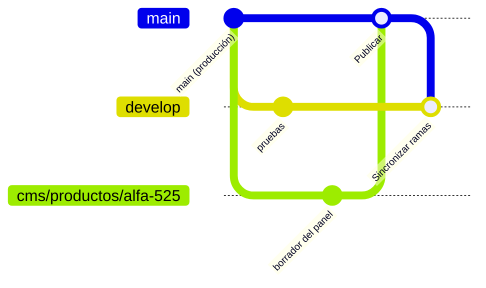

# Diseño técnico: despliegue, entornos y tareas automáticas

Vuelta a la [arquitectura](../ARQUITECTURA.md).

## 1. Cloudflare Pages

| Ajuste | Valor |
|---|---|
| Proyecto | `maquinas-de-coser-zafra` (tipo **Pages**, no Worker: hacen falta `functions/` y `CF_PAGES_BRANCH`) |
| Repositorio | GitHub `vrspunk-87/tienda-online` (privado), «Build system» versión 3 |
| Rama de producción | `main` |
| Ramas de vista previa | Todas; con panel solo `develop` y `dev-victor` (`RAMAS_CON_PANEL` en `lib/origenes.js`) |
| Orden de build | `npm run build` |
| Carpeta publicada | `dist` |
| Funciones | `functions/api/*.js` (se empaquetan después del build: incluyen `lib/generado/solicitud-datos.js`) |
| Cabeceras y redirecciones | `public/_headers`, `public/_redirects` (se copian a `dist/`) |
| Duración típica | ≈7 min (sin caché de imágenes entre despliegues) |

### Variables

| Variable | Producción | Pruebas | Uso |
|---|---|---|---|
| `NODE_VERSION` | `22` | `22` | Versión de Node del build |
| `OAUTH_CLIENT_ID`, `OAUTH_CLIENT_SECRET` (secreto) | Sí | No (el login se hace en producción) | App OAuth de GitHub del panel |
| `PANEL_ORIGENES` | Opcional | — | Sustituye la lista de webs permitidas del login |
| `SOLICITUDES_URL`, `SOLICITUDES_SECRETO` | Hoja de la tienda | Hoja de pruebas | Script de Google |
| `ALTCHA_SECRETO` | Sí | Sí | «No soy un robot» |
| `DIAGNOSTICO_CLAVE` | Sí | Opcional | `/api/estado-solicitudes` |

Las claves **nunca** van en el código. Al cambiar una variable hay que volver a desplegar.

## 2. Dominio

| Pieza | Configuración |
|---|---|
| Dominio | `maquinasdecoserzafra.es`, comprado en Strato, **DNS en Strato** (Strato no deja delegar los `.es`) |
| `www` | CNAME `www` → `maquinas-de-coser-zafra.pages.dev.`; dominio personalizado en Pages → «Activo» con certificado |
| Sin `www` | Redirección 301 en Strato a `https://www.maquinasdecoserzafra.es` |
| Correo de Strato | Registros MX, SPF, DKIM y DMARC sin tocar |
| Entornos de prueba | Siguen en `<rama>.maquinas-de-coser-zafra.pages.dev`: con DNS externos, Pages asocia los dominios propios siempre a producción |
| Constante en el código | `DOMINIO_PROPIO` en `lib/origenes.js`; URL pública en Ajustes → General (`avanzado.url`) |

Pendiente para la salida (ver [PLAN.md](../PLAN.md)): activar `indexable`, redirigir la `pages.dev` de
producción al dominio y quitar de la app OAuth la URL de vuelta de `pages.dev`.

## 3. Ramas

- **Panel de producción** → ramas `cms/…` → fusión en `main`.
- **Cambios de código** → los prepara Víctor (Claude solo modifica ficheros) y los sube con commit y push;
  normalmente directos a `main` o por `develop`.
- **`sincronizar-ramas.yml`** mantiene `develop` y `dev-victor` al día con `main`.

## 4. GitHub Actions y Dependabot

| Fichero | Cuándo | Qué hace | Necesita |
|---|---|---|---|
| `.github/workflows/reconstruccion-diaria.yml` | 00:07 hora de Madrid (dos `cron`, verano e invierno) | Llama al *deploy hook* de producción: las ofertas empiezan y terminan a su hora | Secreto `CF_DEPLOY_HOOK_MAIN` (Cloudflare → Settings → Builds → Deploy hooks, rama `main`) |
| `.github/workflows/sincronizar-ramas.yml` | Cada push a `main` (y a mano) | Fusiona `main` en `develop` y `dev-victor`; si hay conflictos, abre un PR. A mano, crea las ramas que falten | Settings → Actions → *Read and write permissions* |
| `.github/workflows/comprobacion-diaria.yml` | 06:41 UTC (y a mano) | Portada de producción 200; `/api/estado-solicitudes` «Todo correcto»; catálogo generado hace menos de 30 h. Si falla, abre o comenta una incidencia y menciona a `avanzado.avisos_github`; al arreglarse, la cierra | Secreto `DIAGNOSTICO_CLAVE` (igual que en Cloudflare producción) |
| `.github/dependabot.yml` | Mensual | Propuestas de npm y de acciones contra `develop`, solo versiones de hace 14 días o más, agrupadas | — |

## 5. Normas de dependencias

- Versiones **exactas** en `package.json` (sin `^`) y `package-lock.json` al día.
- Solo versiones publicadas hace **al menos dos semanas** (también las acciones de GitHub).
- `npm audit` sin vulnerabilidades.
- Nada servido desde CDN: el build copia a `dist/vendor/` lo que necesita el navegador (Bootstrap, iconos,
  letras, ALTCHA, Decap en `public/admin/vendor/`).

## 6. Caché de imágenes (mejora pendiente)

Cloudflare no conserva `node_modules/.cache/tienda` entre despliegues, así que cada build rehace las ≈4.900
versiones WebP. Si el build pasa de unos 12 minutos (límite: 20), la alternativa prevista es compilar en
GitHub Actions guardando la caché (`actions/cache`) y publicar con `wrangler pages deploy`.

## 7. Comprobar un despliegue

1. En Cloudflare → Deployments: estado «Success» y registro sin «Aviso:» nuevos.
2. La web del entorno: portada, una ficha, `/presupuesto/`, `/buscar/?q=…`.
3. `/api/estado-solicitudes?clave=…` en ese entorno.
4. El panel del entorno: entrar y abrir una ficha.
