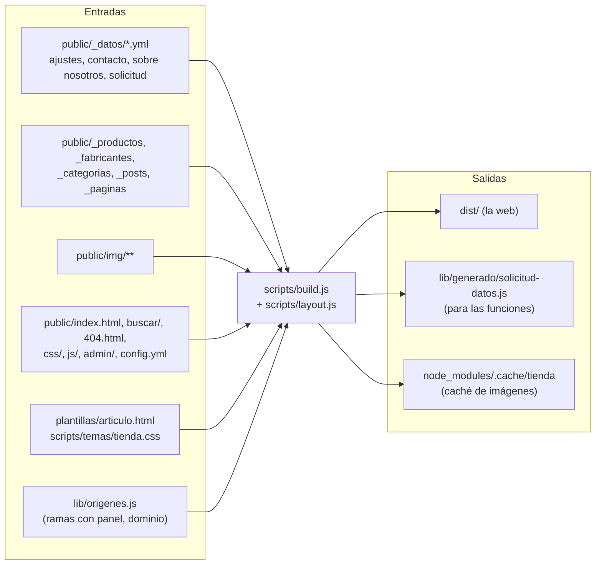

# Diseño técnico: el generador (`scripts/build.js`)

El generador convierte el contenido de `public/` en la web publicada `dist/`. Se ejecuta en Cloudflare
Pages en cada despliegue (`npm run build`) y en local. Es un único script de Node 22 (≈3.600 líneas,
organizado en secciones numeradas) más `scripts/layout.js` (cabecera y pie).

Vuelta a la [arquitectura](../ARQUITECTURA.md).

## 1. Entradas y salidas



Variables de entorno:

| Variable | Valor | Efecto |
|---|---|---|
| `CF_PAGES_BRANCH` | La pone Cloudflare | `main` → producción; otra rama → entorno de pruebas con ese nombre |
| `ENTORNO_WEB` | `produccion`, `develop`, `local`… | Fuerza el entorno (por ejemplo, para probar en local) |
| `RAMA_GIT` | Rama | Rama que editará el panel de ese entorno |
| `INFORME_BUILD` | Ruta de un fichero | Escribe un informe JSON con avisos, notas y cifras |

Sin variables, el entorno es **local**.

## 2. Pasos

| Sección | Qué hace |
|---|---|
| Ajustes del sitio | Lee `sitio.yml` (nombre, colores, menú, portada, precios, panel, zona horaria…) y deduce el entorno |
| Lectura del contenido | `leerColeccion()` lee los `.md` (también en subcarpetas por año) y separa lo «Solo para pruebas» |
| **1** | Copia `public/` a `dist/` (sin las carpetas de contenido `_*`) |
| **2** | Imágenes con nombre descriptivo: cada imagen se publica con el título de su contenido (si se usa en varios sitios, con el primero) |
| **3** | Datos: blog, páginas, contacto, sobre nosotros, solicitud; marcadores legales (`rellenarDatos`) |
| **3b** | Catálogo: fabricantes, árbol de categorías (`nivel`, `padre`, orden de `catalogo_orden`), productos (estados, ofertas, dos precios, compatibles, texto alternativo automático) y sus **avisos** |
| **4** | Optimización de imágenes con `sharp`: WebP a 480, 960 y 1600 px (nunca más que el original), con **caché** por huella del fichero en `node_modules/.cache/tienda` |
| **4b** | Imágenes automáticas para compartir (1200 × 630) con el título dibujado con `opentype.js`, cuando una página no tiene imagen |
| **5** | Piezas de HTML: tarjetas de producto y del blog, rejillas, filtros, migas, compartir, bloques de la portada |
| **6** | `<head>`: título, descripción (≤ 155 caracteres), canónica, Open Graph, Twitter, JSON-LD, iconos, tema y colores (`css/tema.css`, `css/personalizado.css`), CSP |
| **7 / 7b** | Entradas del blog, `/blog/` con paginación y `/blog/tema/<tema>/` |
| **8 / 8b** | Páginas; Contacto y horario y Sobre nosotros a partir de sus YAML |
| **9** | Catálogo: fichas `/productos/…`, páginas de tipo, categoría y subcategoría, `/catalogo/`, `/ofertas/…`; listas largas en JSON aparte |
| **9c** | Solicitud: `/presupuesto/`, `presupuesto/productos.json`, `lib/generado/solicitud-datos.js`, cabecera de los correos (PNG) |
| **10** | Portada, `/blog/`, 404 y cualquier otro HTML de `public/` (huecos `data-*` de las plantillas) |
| **11** | `sitemap.xml`, `robots.txt`, `site.webmanifest`; `dist/config.yml` del panel ajustado al entorno; iconos a partir del favicon; `datos-panel.json`, `medios.json`, `conteos.json`, `correos.js` |
| **13** | Feed RSS del blog (si hay entradas) |
| **13b** | Quita de `dist/` los originales de las fotos que nada generado usa (solo se publican sus WebP) |
| **14** | Índice del buscador con Pagefind (`/pagefind/`), con reintentos |
| **15** | Comprobación de enlaces internos rotos (respeta `public/_redirects`) |
| Resumen | Cifras, tamaño publicado, avisos agrupados e informe |

## 3. Plantillas y HTML

- Las páginas se montan como texto con funciones de JavaScript (*template literals*) y se rellenan
  plantillas de `public/` (`index.html`, `buscar/index.html`, `404.html`) y `plantillas/articulo.html` con
  `node-html-parser`, buscando huecos `data-*` (`data-portada`, `data-bloques-portada`, `data-hero-*`…).
- `scripts/layout.js` construye la cabecera (menú en dos filas, barra del catálogo, versión móvil) y el pie
  a partir de los ajustes.
- Todo el HTML que viene del contenido (Markdown con `marked`) pasa por **`sanitize-html`**
  (`limpiarHtml`).
- No hay scripts en línea: todo el JavaScript está en ficheros de `public/js/` (por la CSP).
- Los datos que necesita el navegador se dejan en atributos `data-*` o en JSON aparte (ver
  [FRONTEND.md](FRONTEND.md)).

## 4. Imágenes

| Qué | Cómo |
|---|---|
| Tamaños | `ANCHOS = [480, 960, 1600]`, solo los menores que el original + el ancho propio (máx. 1600) |
| Nombre | `/img/opt/<carpeta>-<nombre>-<ancho>.webp` |
| Caché | `node_modules/.cache/tienda/<huella>-<ancho>.webp` (`VERSION_CACHE` invalida todo si cambia el proceso). En Cloudflare se pierde entre despliegues: por eso el build tarda unos 7 minutos |
| Compartir | JPG de 1200 px de la foto principal (`-1200.jpg`) para og:image, JSON-LD y RSS |
| Correos | JPG de 160 px (`-correo.jpg`) |
| Originales | No se publican si nada generado los usa (13b) |
| Formatos | Aviso si un formato no se ve en los navegadores (HEIC, TIFF, JXL…) |
| Peso del repositorio | Aviso a partir de 700 MB |

## 5. Avisos y notas

- `console.warn('Aviso: …')`: algo que alguien debe corregir (falta un modelo, referencia repetida, oferta
  mal escrita, enlace roto, dato legal sin rellenar…). Se ven en el registro del despliegue.
- `nota(…)`: información (contenido de pruebas no publicado, oferta terminada, descripciones acortadas…).
- El build **no se para** por avisos: publica igualmente.
- Objetivo al cerrar un cambio: «0 enlaces rotos» y ningún «Aviso:» nuevo.

## 6. Cómo ampliar el generador

| Quiero… | Pasos |
|---|---|
| Un campo nuevo en productos | 1) Campo en `public/config.yml`. 2) Leerlo en la sección 3b (objeto del producto). 3) Pintarlo en la ficha (sección 9) y, si hace falta, en `vista-previa.js`. 4) Si se exporta a Excel, en `PERFILES` de `public/admin/excel/nucleo.js`. 5) Documentarlo en el README y en [MODELO-DE-DATOS.md](MODELO-DE-DATOS.md) |
| Un ajuste nuevo del sitio | Campo en la colección `ajustes` de `config.yml`, su sitio en `PESTANAS_AJUSTES` (panel.js), su ayuda en `public/admin/ayuda-ajustes.yml` y leerlo en la cabecera de `build.js` |
| Una página fija nueva | HTML en `public/` (se copia y se completa en la sección 10) o una página del panel (`paginas`) |
| Un aviso nuevo | `console.warn('Aviso: …')` en la sección donde se detecta |

## 7. Comprobar

```bash
npm ci
ENTORNO_WEB=produccion RAMA_GIT=main npm run build   # como producción
ENTORNO_WEB=develop RAMA_GIT=develop npm run build   # como un entorno de pruebas
npm test                                             # pruebas de la solicitud y del Excel del panel
```

En el equipo de Víctor, los builds de comprobación se hacen en una copia fuera de su carpeta: su `dist/` es
el que sirve su panel local.
