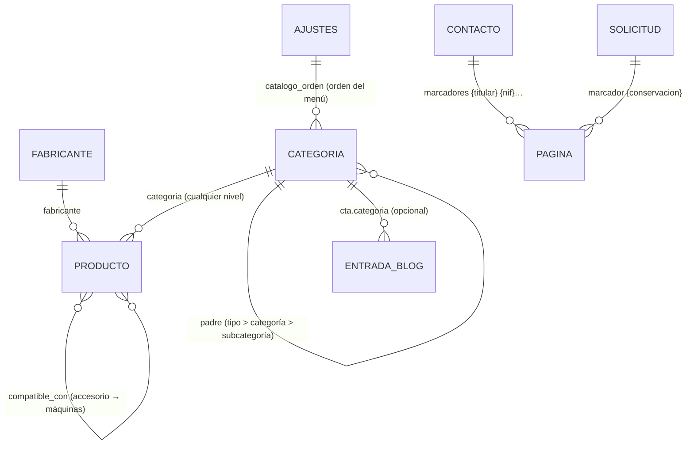

# Diseño técnico: modelo de datos

Todo el contenido de la web son **ficheros de texto en el repositorio**: Markdown con cabecera YAML
(*frontmatter*) para las fichas y YAML para los datos únicos. Los crea y modifica el panel (Decap) según
`public/config.yml`; el generador los lee en cada despliegue. No hay base de datos.

Vuelta a la [arquitectura](../ARQUITECTURA.md).

## 1. Colecciones

| Colección (panel) | `name` en config.yml | Ficheros | Identificador (= nombre del fichero) | Dirección en la web |
|---|---|---|---|---|
| Entradas del blog | `blog` | `public/_posts/blog/<año>/<fecha>-<slug>.md` | `{{year}}-{{month}}-{{day}}-{{slug}}` | `/blog/<identificador>/` |
| Páginas | `paginas` | `public/_paginas/<slug>.md` | `{{slug}}` | `/paginas/<slug>/` |
| Tipos de producto | `tipos` | `public/_categorias/<slug>.md` con `nivel: tipo` | `{{slug}}` | `/catalogo/<tipo>/` |
| Categorías | `categorias` | ídem con `nivel: categoria` | `{{slug}}` | `/catalogo/<tipo>/<categoría>/` |
| Subcategorías | `subcategorias` | ídem con `nivel: subcategoria` | `{{slug}}` | `/catalogo/<tipo>/<categoría>/<subcategoría>/` |
| (oculta) catálogo | `catalogo` | todo `public/_categorias` | — | Sirve para elegir cualquier nivel en relaciones |
| Productos | `productos` | `public/_productos/<fabricante>-<modelo>.md` | `{{fields.fabricante}}-{{fields.modelo}}` (no cambia aunque cambie el modelo) | `/productos/<identificador>/` |
| Fabricantes | `fabricantes` | `public/_fabricantes/<slug>.md` | `{{slug}}` | Sin página (logo y filtros) |
| Solicitud de presupuesto | `solicitud` | `public/_datos/solicitud.yml` | — | `/presupuesto/` |
| Contacto y horario | `contacto` | `public/_datos/contacto.yml` | — | `/paginas/contacto-y-horario/` |
| Sobre nosotros | `sobre_nosotros` | `public/_datos/sobre-nosotros.yml` | — | `/paginas/sobre-nosotros/` |
| Ajustes del sitio | `ajustes` | `public/_datos/sitio.yml` | — | Toda la web |

Los identificadores se escriben sin tildes ni caracteres raros (`slug.encoding: ascii`, `clean_accents`).
**Cambiar el título no cambia el identificador ni la dirección.**

## 2. Diagrama de relaciones

## 3. Campos

`*` = obligatorio en el panel. Todos los tipos de ficha llevan `prueba` (booleano, «Solo para pruebas»).

### Producto (`public/_productos/*.md`)

| Campo | Tipo | Notas |
|---|---|---|
| `title`* | texto | Nombre descriptivo (sale como título) |
| `fabricante`* | relación → fabricantes | Identificador del fabricante |
| `modelo`* | texto | Forma el identificador junto con el fabricante |
| `referencia` | texto | Entre comillas si empieza por cero (`"0342297101"`): si no, YAML la lee como número |
| `categoria`* | `categoria-catalogo` (widget propio) | Identificador del nivel más concreto elegido |
| `compatible_con` | lista de relaciones → productos | Solo accesorios |
| `date` | fecha | «Fecha de alta»: ordena por novedad |
| `precio` | `precio-producto` | Con IVA. En el tipo de dos precios, es el de la máquina **completa**. Vacío = «Precio a consultar» |
| `precio_cabezal` | `precio-producto` | Solo en el tipo `tipo_dos_precios` (máquinas industriales) |
| `estado`* | `disponible` · `oferta` · `no_disponible` | |
| `oferta.precio`, `oferta.precio_cabezal`, `oferta.inicio`, `oferta.fin` | | Fechas por días, ambas incluidas, hora de Madrid |
| `condicion`* | `nuevo` · `segunda_mano` | |
| `segunda_mano.estado`, `segunda_mano.garantia` | texto, número (meses) | Garantía ≥ 12 |
| `imagenes`* | lista de `{ imagen, alt }` | Máximo 5 publicadas; la primera es la principal |
| `description` | texto | «Resumen»: ≤ 155 caracteres (Google) |
| `destacados` | lista de `{ texto }` | Pestaña «Características» |
| `caracteristicas` | lista de `{ nombre, valor }` | Pestaña «Ficha técnica»; sin nombre, el valor ocupa la fila |
| `ficha_pdf` | fichero | En `public/img/fichas` |
| cuerpo | Markdown | Pestaña «Descripción» |

### Catálogo (`public/_categorias/*.md`)

| Campo | Notas |
|---|---|
| `nivel` (oculto) | `tipo`, `categoria` o `subcategoria`; distingue la colección |
| `title`*, `description`, `imagen`, `imagen_alt`, cuerpo | Texto de su página y tarjetas |
| `padre`* | Solo categorías (→ tipo) y subcategorías (→ categoría). El build avisa si el nivel no cuadra |

El orden no es un campo: se decide en **Ajustes del sitio → «Orden del catálogo en el menú»** (`catalogo_orden`
en `sitio.yml`). Lo que no está ahí va al final de su nivel, en alfabético, con aviso del build.

### Fabricante, blog y páginas

| Ficha | Campos |
|---|---|
| Fabricante | `title`*, `imagen` (logo) |
| Entrada del blog | `title`*, `date`*, `tema`, `description`, `descripcion_google`, `thumbnail`, `thumbnail_alt`, cuerpo*, `cta { mostrar, categoria, texto, boton }` |
| Página | `title`*, `description`, `descripcion_google`, `imagen`, `imagen_alt`, cuerpo, `noindex` |

### Datos únicos (`public/_datos/`)

| Fichero | Contenido principal |
|---|---|
| `sitio.yml` | Nombre, descripción, logo, imagen al compartir, `portada`, `pagina_catalogo`, `pagina_ofertas`, `pagina_blog`, `apariencia`, `navbar`, `catalogo_vacias`, `insignias_productos`, `catalogo_orden`, `menu`, `legales`, `redes`, `imagenes` (compresión), `avanzado` (URL, `indexable`, avisos de GitHub), `precios`, `relacionados`, `novedad_dias`, `panel_*` (ajustes del panel), `zona_horaria` y `franja` (aviso arriba entre dos fechas; solo existe si se rellena) |
| `contacto.yml` | `provisional`, `titular`, `nif`, teléfono, WhatsApp, correo, dirección, CP, localidad, provincia, enlace a Maps, `horario` (grupos de días con mañana y tarde), `nota_horario`, `aviso` (cierre con fechas), `como_llegar` |
| `sobre-nosotros.yml` | `provisional`, presentación, foto, galería, `desde`, `cifras`, `servicios`, `porque`, `historia`, `marcas` |
| `solicitud.yml` | `activa`, textos, `aceptacion`, `info_privacidad`, `conservacion_meses`, `ventajas`, `preferencia_contacto`, `accesorios`, `notas`, `mensaje_exito`, `acuse`, `aviso_tienda`, `limites` |

## 4. Reglas del catálogo

| Regla | Dónde se aplica |
|---|---|
| **Solo para pruebas**: no se publica en producción. Si lo es un fabricante o una categoría (o un nivel superior), tampoco sus productos | `build.js` (`ramaEnPruebas`, `ocultosPorPadre`) |
| **No disponible**: no se publica (ni sus fotos), su dirección da 404 y no genera avisos. Solo cambia a mano | `build.js` |
| **En oferta**: precio de oferta entre `inicio` y `fin` (días completos, hora de Madrid). Fuera de fechas se muestra el precio normal sin tocar el fichero. Precio de oferta ≥ normal → no se muestra como oferta (aviso) | `build.js`, `extras.js` (días que quedan), `lib/solicitud.js` (precio respetado por fecha de envío) |
| **Dos precios**: solo en el tipo de producto que indica `tipo_dos_precios` en los campos de precio de `config.yml` (hoy, `maquinas-industriales`). En la solicitud, el cabezal es `<identificador>~cabezal` | `build.js`, `campos.js`, `presupuesto.js`, `lib/solicitud.js` |
| **Accesorios**: `compatible_con` en el accesorio; la máquina lo muestra en «Accesorios». Al borrar una máquina se quita de los accesorios | `build.js`, `eliminar.js`, `nucleo.js` |
| **Fotos**: máximo 5 publicadas; texto alternativo automático si falta («Nombre de Fabricante, foto 2 de 4») | `build.js` |
| **Referencias**: aviso si se repiten | `build.js`, tablas del panel |
| **Segunda mano**: garantía ≥ 12 meses (aviso) | `build.js` |
| **Tipos y categorías vacíos**: se ocultan de toda la web con `catalogo_vacias: ocultar` | `build.js` |

## 5. Marcadores en los textos

Los textos legales y los de la solicitud usan marcadores que el build (y la vista previa y «Exportar a
Word») rellenan: `{titular}`, `{nif}`, `{nombre_comercial}`, `{direccion}`, `{correo}`, `{telefono}` (de
`contacto.yml`) y `{conservacion}` (de `solicitud.yml`, «6 meses»). Si falta un dato sale «[NIF]» y el build
avisa. En «Sobre nosotros», `{años}` y `{marcas}` se calculan.

## 6. Datos generados (no se editan)

| Fichero | Lo genera | Para qué |
|---|---|---|
| `dist/presupuesto/productos.json` | build | Nombres, precios, ofertas y fotos de cada producto (y `~cabezal`) para la solicitud en el navegador |
| `lib/generado/solicitud-datos.js` | build (ignorado por Git) | Catálogo con el que la función recalcula la solicitud, textos, límites y diseño de los correos |
| `dist/admin/datos-panel.json` | build | Nombres del catálogo, fabricantes, datos legales y ajustes del panel para vistas previas y tablas |
| `dist/admin/medios.json`, `conteos.json` | build | Lista de archivos de Medios en local, miniaturas, manuales; productos por categoría |
| `dist/config.yml` | build | `config.yml` ajustado por entorno: rama del panel, filtros por fabricante y categoría, peso máximo |
| `dist/catalogo/tarjetas-<huella>.json`, `dist/blog/entradas-<huella>.json` | build | Tarjetas de las listas largas, que se cargan aparte |
