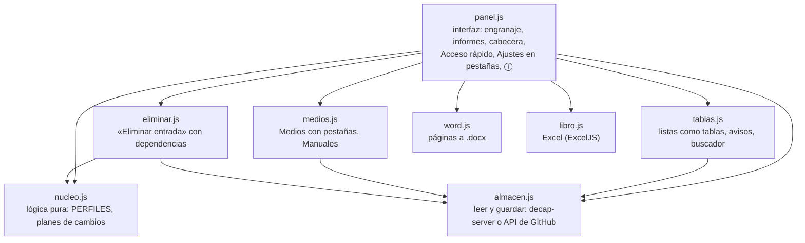

# Diseño técnico: el panel (`/admin/`)

El panel es **Decap CMS 3.3.3** servido desde la propia web, con varios módulos propios que lo adaptan a la
tienda: campos, vistas previas con el aspecto de la web, tablas en lugar de las listas de Decap, Excel,
cambios en bloque, Medios con pestañas y borrado con dependencias. Uso para la tienda: manual del panel en
PDF ([`docs/manuales/`](../manuales/)).

Vuelta a la [arquitectura](../ARQUITECTURA.md).

## 1. Carga

`public/admin/index.html` carga, por este orden:

| Fichero | Tipo | Qué aporta |
|---|---|---|
| `/config.yml` (`public/config.yml`, ajustado por el build) | configuración | Colecciones, campos, *backend*, flujo editorial |
| `/admin/tema-panel.css` | CSS | Estética de la web y panel adaptado al móvil |
| `/admin/vendor/decap-cms-3.3.3.js` | script | Decap (sin CDN) |
| `/admin/vista-previa.js` | script | Plantillas de vista previa (`registerPreviewTemplate`) y estilos de la web |
| `/admin/campos.js` | script | Widgets `categoria-catalogo` y `precio-producto` |
| `/admin/excel/panel.js` | módulo ES | Todo lo demás (ver §4) |

Datos que el build deja para el panel: `/admin/datos-panel.json` (catálogo, fabricantes, datos legales,
ajustes del panel, marca), `/admin/medios.json` (lista de archivos en local, miniaturas, manuales),
`/admin/conteos.json` (productos por categoría), `/admin/correos.js` (copia de `lib/correos.js`) y
`/admin/ayuda-ajustes.yml` (burbujas ⓘ).

## 2. *Backend*, entornos y flujo editorial

| Entorno | *Backend* | Rama que edita | Notas |
|---|---|---|---|
| Producción | GitHub (`vrspunk-87/tienda-online`), login por `/api/auth` | `main` | `base_url` = dominio de producción |
| `develop`, `dev-victor` | ídem | su rama (`backend.branch` lo cambia el build) | `cms_label_prefix` propio para no mezclar borradores; franja amarilla «Panel de pruebas» |
| Otras ramas | — | — | El build sustituye el panel por una página «Sin panel» |
| Local | `local_backend` (`npm run panel` → decap-server en `:8081`) | Tu copia | Sin login |

`publish_mode: editorial_workflow`: cada ficha guardada crea una rama `cms/<colección>/<ficha>` con un Pull
Request (Borrador → En revisión → Listo); «Publicar» lo fusiona. Login: [SEGURIDAD.md](SEGURIDAD.md).

Además, el build añade a `dist/config.yml` los filtros de la lista de productos (uno por fabricante y por
categoría) y el peso máximo de subida en todos los campos de imagen o fichero.

## 3. Campos y vistas previas

| Pieza | Fichero | Detalle |
|---|---|---|
| `categoria-catalogo` | `campos.js` | Desplegables dependientes Tipo › Categoría › Subcategoría en el orden de Ajustes; guarda el nivel más concreto. Opciones `niveles` y `obligatorios`. Se relee al abrir cada ficha |
| `precio-producto` | `campos.js` | Precio o «Completa» + «Cabezal» según el tipo de producto (`tipo_dos_precios`) |
| Vistas previas | `vista-previa.js` | Blog, páginas (con marcadores rellenos), productos, tipos/categorías/subcategorías, fabricantes, contacto, sobre nosotros y solicitud (con los dos correos). Aproximadas: la página real la hace el build |

## 4. Módulos propios (`public/admin/excel/`)



| Módulo | Responsabilidad |
|---|---|
| `nucleo.js` | Sin red ni DOM. `PERFILES` (columnas de cada colección para Excel), cálculo del **plan** de una importación o acción en bloque (qué fichas cambian, avisos, ficheros a escribir y borrar). Probado con `lib/excel-panel.test.mjs` |
| `libro.js` | Crear y leer el Excel: hojas «Instrucciones», datos, «Notas», «Listas» (oculta) y «Control» (muy oculta: huellas para detectar cambios posteriores) |
| `almacen.js` | En local, decap-server; en la web, API de GitHub con el token de la sesión de Decap. Lee con una consulta por carpeta (GraphQL/árboles) y **guarda todo en un único commit** en la rama del panel, reintentando si otra persona guardó a la vez |
| `panel.js` | Engranaje de cada lista (Exportar/Importar Excel, «Solo para pruebas» y «No disponible» en bloque, Eliminar), informes en pestañas con tablas, cabecera (Acceso rápido, buscador, engranaje de Ajustes solo para `ADMINISTRADORES`), Ajustes en pestañas Web/Panel/General (`PESTANAS_AJUSTES`), burbujas ⓘ, confirmaciones con avisos |
| `tablas.js` | Sustituye las listas de Decap en Productos, Fabricantes, Tipos, Categorías y Subcategorías: grupos, filtros, orden, paginación, columna de avisos (⚠), estado al volver de una ficha; buscador general con tablas |
| `medios.js` | «Medios» con pestañas por carpeta (General, Catálogo, Productos, Fichas PDF, Fabricantes) y **Manuales** (los PDF sueltos de `docs/manuales`, solo lectura: abrir y descargar; no lista la subcarpeta `fuentes/`); En uso/Sin usar, subir (reduce fotos a 1600 px), descargar, reemplazar, eliminar solo lo no usado |
| `eliminar.js` | Intercepta «Eliminar entrada publicada»: comprueba dependencias (accesorios, productos de un fabricante o categoría, menú, fotos) y lo hace en un único cambio o explica por qué no |
| `word.js` | «Exportar a Word» de las páginas, con marcadores rellenos y huecos en amarillo |

Las acciones del engranaje **no** pasan por el flujo editorial: se publican al guardar (con informe previo y
confirmación).

## 5. Permisos

- Puede editar quien tiene **permiso de escritura en el repositorio de GitHub**.
- El engranaje de «Ajustes del sitio» solo se muestra a `ADMINISTRADORES` (panel.js) o a los de
  `panel_administradores` en Ajustes. **No es una protección real**: quien puede escribir en el repositorio
  puede cambiar cualquier fichero.

## 6. Puntos frágiles al actualizar Decap

Decap no ofrece puntos de extensión para todo lo anterior; algunos módulos se apoyan en su HTML:

| Dependencia | Dónde |
|---|---|
| Clases CSS generadas (`[class*="-StyledModal"]`, `-LibraryTop`, `-CardGridContainer`…) | medios.js, panel.js |
| Textos de botones («Eliminar entrada publicada», «Eliminar cambios no publicados»…) | eliminar.js |
| Rutas `#/collections/<nombre>` y `#/collections/<nombre>/entries/<ficha>` | panel.js, tablas.js |
| `media_library.config.max_file_size` por campo (un `media_library` general rompe Decap 3.3) | config.yml |

Al actualizar Decap: sustituir `public/admin/vendor/decap-cms-<versión>.js`, cambiar la referencia en
`index.html` y repasar los planes de prueba del panel ([`docs/pruebas/`](../pruebas/)). El script
`scripts/actualizar-decap.js` que citan algunos comentarios **no existe todavía** en este repositorio.

## 7. Probar

```bash
npm run web      # en una ventana: genera y sirve la web (http://localhost:3000)
npm run panel    # en otra: decap-server; el panel en http://localhost:3000/admin/
npm test         # incluye lib/excel-panel.test.mjs (Excel y planes de cambios)
```
