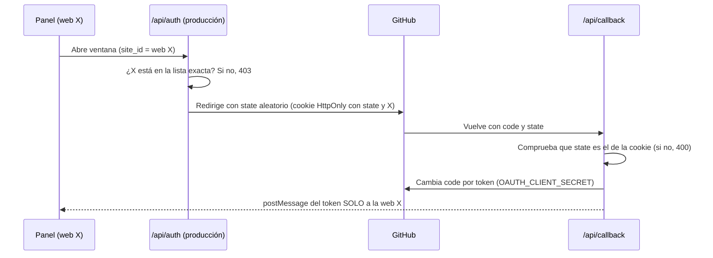

# Diseño técnico: seguridad y datos personales

Resumen de las medidas de seguridad de la web, el panel y las solicitudes. Lo que se cambie aquí hay que
explicarlo siempre en el resumen del cambio (norma de [CLAUDE.md](../../CLAUDE.md)).

Vuelta a la [arquitectura](../ARQUITECTURA.md).

## 1. Superficie

| Elemento | Expuesto a | Protección |
|---|---|---|
| Web estática | Todo el mundo | CSP estricta, HTML saneado, cabeceras, sin cookies |
| `/admin/` | Todo el mundo (la página), pero edita solo quien tiene permiso en GitHub | Login OAuth con GitHub; `noindex` |
| `/api/auth`, `/api/callback` | Todo el mundo | `state` en cookie `HttpOnly`, lista exacta de webs |
| `/api/solicitud`, `/api/desafio` | Todo el mundo | Origen, antispam, ALTCHA, límites, validación, precios del servidor |
| `/api/estado-solicitudes` | Solo con la clave | `DIAGNOSTICO_CLAVE` comparada en tiempo constante; 404 si no |
| Script de Google | Internet (URL `/exec`) | Clave compartida; `@OnlyCurrentDoc`; topes |

## 2. Login del panel

- Lista exacta en `lib/origenes.js`: `maquinas-de-coser-zafra.pages.dev`, `develop.…`, `dev-victor.…`,
  `maquinasdecoserzafra.es` y `www.maquinasdecoserzafra.es`. **Sin comodines** en `pages.dev`, que es un
  dominio compartido por todos los clientes de Cloudflare.
- La app OAuth de GitHub tiene una URL de vuelta exacta y tokens sin caducidad (Decap no los renueva).
- El token de GitHub da acceso a los repositorios de quien edita: por eso nunca se entrega a otra web.
- El engranaje del panel usa ese mismo token desde el navegador: no hay funciones ni claves nuevas.

## 3. Web pública

- **CSP** en cada página (ver [FRONTEND.md](FRONTEND.md#4-política-de-seguridad-de-contenidos-csp)): sin
  scripts en línea, solo scripts y conexiones a la propia web.
- **`sanitize-html`** en todo el HTML que viene del contenido.
- **Cabeceras** (`public/_headers`): `nosniff`, `Referrer-Policy`, `X-Frame-Options: SAMEORIGIN`,
  `Permissions-Policy` (sin cámara, micrófono, ubicación ni pagos); SVG con CSP propia y *sandbox*.
- **Sin terceros**: nada de CDN, analítica ni fuentes de Google; el mapa de Google solo si se pulsa.
- **Antispam de contacto**: teléfono, correo y WhatsApp codificados en el HTML (`ocultarContacto`).
- **Nunca un formulario de pago** (lo prohíbe el plan gratuito de Cloudflare y la tienda no cobra en la web).

## 4. Solicitudes

| Riesgo | Medida |
|---|---|
| Robots y envíos masivos | Campo trampa, tiempo mínimo, límite por conexión (5 en 10 min), ALTCHA de un solo uso, máximo de enlaces, límite global por hora en el script, topes diarios de correos |
| Precios manipulados | Se recalculan con el catálogo publicado; el navegador solo manda identificadores y cantidades |
| Usar el formulario para mandar correos a terceros | El acuse al cliente no lleva nada escrito por el cliente |
| Inyección en la hoja | Todo como texto y con fórmulas neutralizadas (`= + - @` al principio) |
| Inyección en el aviso a la tienda | Datos escapados; enlaces solo los que monta el código |
| Escritura no autorizada en la hoja | Clave compartida `SOLICITUDES_SECRETO`; script limitado a su hoja |
| Peticiones desde otras webs | `Origin`/`Referer` debe ser la propia web |

## 5. Datos personales

| Dato | Dónde | Cuánto tiempo |
|---|---|---|
| Nombre, teléfono, correo, preferencia, observaciones, notas, productos | Hoja de Google y Gmail de la tienda | Sin venta: `conservacion_meses` (6). Con venta: plazos legales. Lo borra la tienda (guía en PDF) |
| Versión del consentimiento | Hoja | Con la solicitud |
| IP | Solo en memoria de la función, para el límite; **no se guarda** | Minutos |
| Solicitud a medio preparar | `localStorage` del cliente, sin datos personales | Hasta enviarla o borrarla |
| Registros de Cloudflare | Mensajes sin datos personales («Solicitud S-… guardada») | Lo que guarde Cloudflare |

Los textos legales que lo explican están en `public/_paginas/` (pendientes de revisión de la asesoría:
[BORRADORES-LEGALES.md](../BORRADORES-LEGALES.md)).

## 6. Claves

| Clave | Dónde vive | Si se filtra |
|---|---|---|
| `OAUTH_CLIENT_SECRET` | Cloudflare (producción) | Regenerarla en la app OAuth de GitHub y actualizar Cloudflare |
| `SOLICITUDES_SECRETO` / `SECRETO` | Cloudflare + propiedades del script | Generar otra (`crearSecreto()` en el script) y actualizar las dos |
| `ALTCHA_SECRETO` | Cloudflare | Cambiarla y volver a desplegar |
| `DIAGNOSTICO_CLAVE` | Cloudflare + secreto de GitHub | Cambiarla en los dos |
| `CF_DEPLOY_HOOK_MAIN` | Secreto de GitHub | Borrar el *hook* en Cloudflare y crear otro |

## 7. Permisos en GitHub

- Editar el panel = permiso de escritura en el repositorio. Dar de alta a cada persona con su usuario.
- Ocultar «Ajustes del sitio» a quien no es administrador es solo comodidad, no seguridad.
- `.claude/settings.json` bloquea a Claude Code las órdenes de Git que cambian el repositorio.
